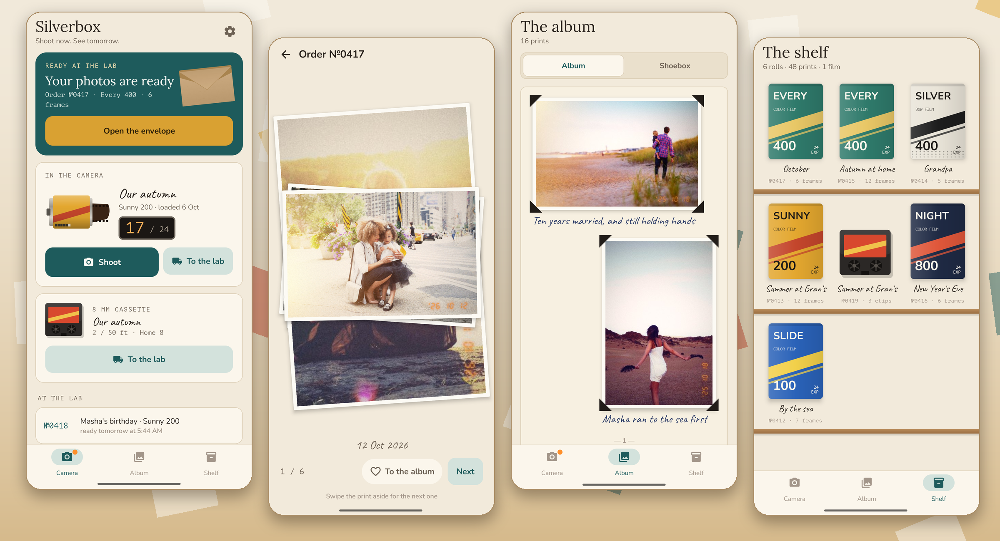

<div align="center">


# Silverbox

### Shoot now. See tomorrow.

*A film camera for the family. Shoot with your phone's own camera, the pictures go on a roll of film, and you won't see a frame until the lab develops it. Free, no ads, no account.*

[](https://github.com/bigdevwhale/silverbox/actions/workflows/android.yml)
[](https://github.com/bigdevwhale/silverbox/releases/latest)


[](LICENSE)

**English** · [Русский](README.ru.md) · [Changelog](CHANGELOG.md)



</div>

---

## The idea

Phones hold thousands of pictures nobody looks at again. Film made every frame count: 24 of them on a roll, a wait at the lab, then an envelope of prints passed round the table. Silverbox brings that back without a new camera to learn.

## How a roll goes round

1. **Load a roll.** Pick a film from the shelf, 24 or 36 frames, and say what it's for: "Summer at Gran's".
2. **Shoot with your phone's camera.** Silverbox opens the camera you already have, with every mode it has: portrait, night, zoom, video. When you come back, whatever it took goes onto the film and the counter clicks on. Optionally the pictures leave the gallery (to its bin), so nobody peeks.
3. **Take it to the lab.** A receipt with an order number. Ordinary development takes a day; express takes an hour, once a week.
4. **Open the envelope.** A kraft envelope, then the prints one by one as a stack. The best go in the album with a heart.

## The films

| Film | Character |
|---|---|
| **Sunny 200** | warm and golden: summer, sun, faces that glow |
| **Every 400** | natural and soft, gentle greens: home and the everyday |
| **Night 800** | coarse grain and a red glow round every light: evenings, garlands |
| **Silver 400** | black and white with deep blacks: portraits, grandparents |
| **Slide 100** | rich and punchy, deep blue skies: travel, the sea |
| **Home 8 / Silver 8** | 8 mm cassettes for video: home movie in colour or black and white |

Every print is developed on the phone: the stock's curve and colour, grain that lives in the mid-tones, halation round bright lights, a vignette, a 10×15 crop and the orange date of an old point-and-shoot. Film behaves like film: the first frame is fogged by the light that got in while loading, and now and then a leak of light comes in from the edge. Film left in the camera more than two months starts to drift: faded, magenta, grainier.

## What's inside

| | Feature | How it works |
|---|---|---|
| 🎞️ | **8 mm cassette** | Videos go on a cassette, 50 clips. The lab splices them whole, adds an intertitle and "The End", and prints it as home movie: 18 frames a second, grain, dust, flicker, gate weave and a flash at every splice, the sound thin as from a projector's speaker. Upright clips make an upright film; nothing is cropped. Watch it in the dark with the projector clattering. |
| ✉️ | **The envelope** | The lab's label on a kraft envelope; the prints come out as a stack you swipe through. |
| 📖 | **Album and shoebox** | The album holds the chosen prints, two to a page, with black photo corners and what you wrote. The shoebox holds everything, loose, by month. |
| ✍️ | **The back of the print** | Turn a print over to write on it by hand, and who took it. The lab's stamp is there too. |
| 🗄️ | **The shelf** | Every developed roll in its box, with a contact sheet and the negatives (upright frames lie on their side, as on film). |
| 📝 | **For this roll** | Three things worth a frame, chosen for each roll: "hands that cook", "an ordinary dinner", "a hug". |
| 📅 | **On this day** | A print from this day in an earlier year. |
| 💾 | **Backup** | One zip with every original, print and film. |

## Privacy

No account, no analytics, no ads, no network at all. Silverbox reads only the camera's own folder (DCIM), and only what was taken after you pressed "Shoot". Everything stays in the app's storage on the phone.

## Build

```bash
./gradlew assembleDebug                 # app.silverbox.dev; the lab takes a minute here
./gradlew assembleDebug -Pdemo          # app.silverbox.demo with a made-up family year on film
./gradlew testDebugUnitTest -Prender    # develops sample prints and draws the screens to app/build/art
python tools/icon.py                    # the launcher icon and docs/logo.png
python tools/projector.py               # the projector's sound, synthesised
```

Kotlin, Jetpack Compose, Room, DataStore, Media3 (ExoPlayer, Transformer). The darkroom is plain pixel work in `develop/Film.kt`; the 8 mm lab is `develop/Movie.kt`.

Demo photos are from [Unsplash](https://unsplash.com) via [Lorem Picsum](https://picsum.photos) (authors in [docs/demo-credits.txt](docs/demo-credits.txt)), used under the Unsplash License, and ship only in the demo build, except three (195, 199, 822) that every build develops on each film for the samples on the film shelf. The film names are the app's own.

## License

[MIT](LICENSE) · part of [Stillcraft](https://bigdevwhale.github.io/stillcraft/)
