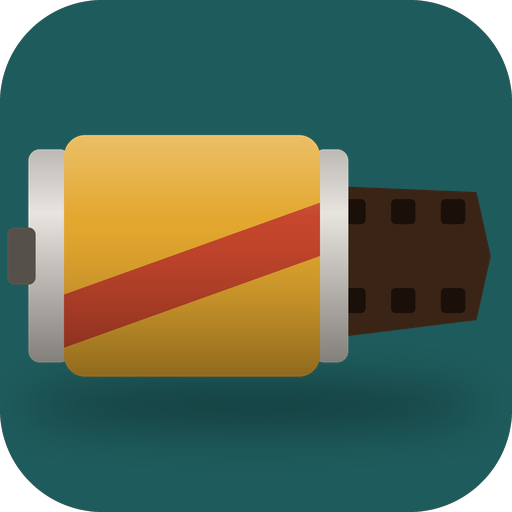

# Silverbox

### Снимай сейчас — смотри завтра.

*Плёночный фотоаппарат для семьи. Вы снимаете обычной камерой телефона, снимки попадают на плёнку, и ни одного кадра вы не увидите, пока плёнку не проявят. Бесплатно, без рекламы и аккаунтов.*

[English](README.md) · **Русский** · [Изменения](CHANGELOG.md)

---

## Идея

В телефоне тысячи снимков, которые никто не пересматривает. Плёнка делала ценным каждый кадр: 24 на плёнке, ожидание в фотоателье, потом конверт с отпечатками, который передают по кругу за столом. Silverbox возвращает это без новой камеры.

## Путь одной плёнки

1. **Зарядите плёнку.** Выберите плёнку на полке, 24 или 36 кадров, и подпишите, для чего она: «Лето у бабушки».
2. **Снимайте камерой телефона.** Silverbox открывает вашу камеру со всеми её режимами: портрет, ночь, зум, видео. Когда вы возвращаетесь, всё снятое попадает на плёнку, счётчик щёлкает. По желанию снимки уходят из галереи в корзину, чтобы никто не подглядывал.
3. **Сдайте в проявку.** Квитанция с номером заказа. Обычная проявка — сутки, срочная — час, раз в неделю.
4. **Откройте конверт.** Крафтовый конверт, а в нём стопка отпечатков, по одному. Лучшие — в альбом, сердечком.

## Плёнки

| Плёнка | Характер |
|---|---|
| **Sunny 200** | тёплая, золотистая: лето, солнце, светящиеся лица |
| **Every 400** | естественная, мягкая, с нежной зеленью: дом и будни |
| **Night 800** | крупное зерно и красный ореол вокруг огней: вечера, гирлянды |
| **Silver 400** | чёрно-белая, с глубоким чёрным: портреты, бабушки и дедушки |
| **Slide 100** | сочная, контрастная, густо-синее небо: путешествия, море |
| **Home 8 / Silver 8** | кассеты 8 мм для видео: домашнее кино в цвете или ч/б |

Каждый отпечаток проявляется на телефоне: кривая и цвет плёнки, зерно в средних тонах, ореолы вокруг ярких огней, виньетка, кадр 10×15 и оранжевая дата старой мыльницы. Плёнка ведёт себя как плёнка: первый кадр засвечен при зарядке, последний кадр полной плёнки обрезан там, где она кончилась, а иногда с края заходит засветка. Плёнка, пролежавшая в камере больше двух месяцев, начинает «плыть»: выцветает, розовеет, зерно грубеет.

## Что внутри

| | Функция | Как работает |
|---|---|---|
| 🎞️ | **Кассета 8 мм** | Видео попадают на кассету, 50 роликов. Ателье вырезает из середины каждого три секунды, добавляет титр и «Конец» и печатает немое домашнее кино: 4:3, 18 кадров в секунду, зерно, пыль, мерцание, дрожание кадра. Смотрите в темноте под стрекот проектора. |
| ✉️ | **Конверт** | Наклейка ателье на крафтовом конверте; отпечатки выходят стопкой, их смахивают по одному. |
| 📖 | **Альбом и коробка** | В альбоме — избранные отпечатки, по два на страницу, в чёрных уголках и с подписями. В коробке из-под обуви — все, по месяцам. |
| ✍️ | **Оборот** | Переверните отпечаток и подпишите от руки, кто снимал. Там же штамп ателье. |
| 🗄️ | **Полка** | Каждая проявленная плёнка в своей коробке, с контактным листом и негативами (вертикальные кадры лежат на боку, как на плёнке). |
| 📝 | **Для этой плёнки** | Три кадра, которые стоит снять: «руки, которые готовят», «обычный ужин», «объятие». |
| 📅 | **В этот день** | Отпечаток из этого же дня в прошлые годы. |
| 💾 | **Резервная копия** | Один zip со всеми оригиналами, отпечатками и фильмами. |

## Приватность

Без аккаунтов, аналитики и рекламы, вообще без сети. Silverbox читает только папку камеры (DCIM) и только то, что снято после нажатия «Снимать». Всё хранится в памяти приложения на телефоне.

## Лицензия

[MIT](LICENSE) · часть [Stillcraft](https://bigdevwhale.github.io/stillcraft/)
